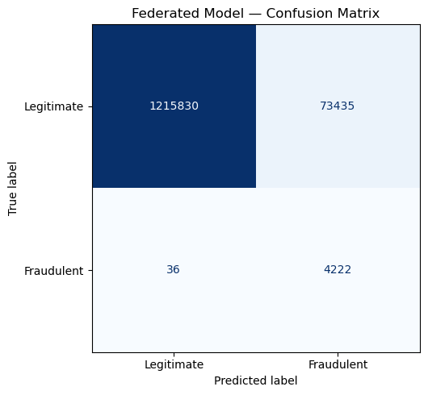
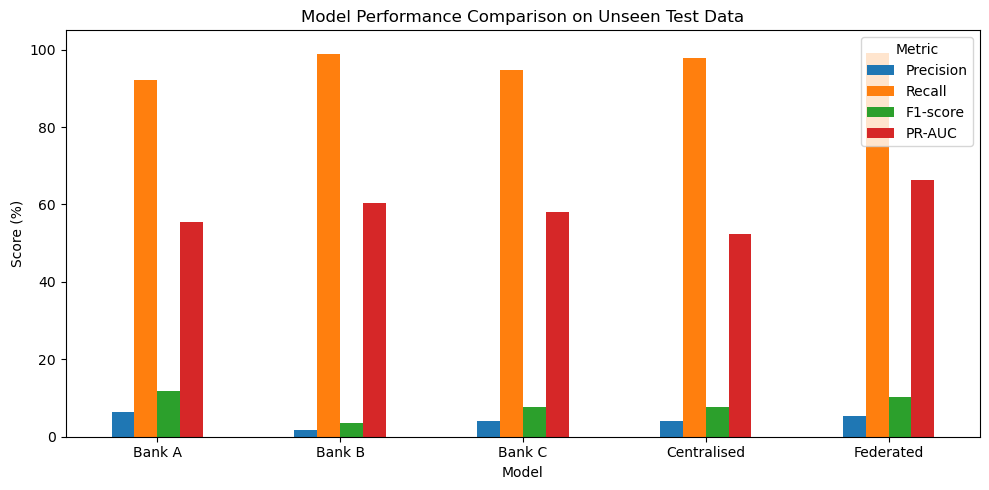
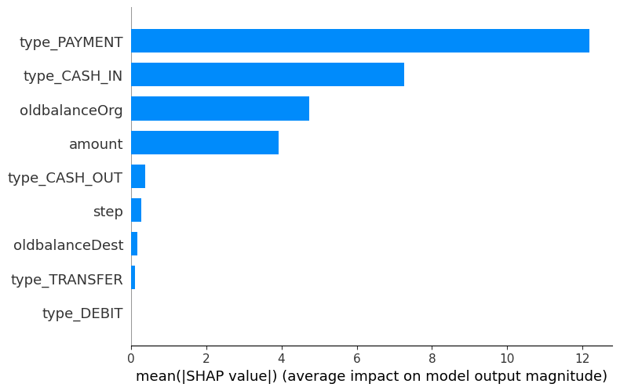

# Federated Explainable Machine Learning for Privacy-Preserving Financial Fraud Detection

A Python research project investigating collaborative financial fraud detection with **Federated Learning (FedAvg)** and **SHAP explainability**. Three simulated banks train a shared neural network while retaining separate training partitions. Local and centralised baselines provide comparisons on chronologically later transactions.

## Aim and motivation

Financial fraud is rare, making accuracy alone an unreliable measure of detection performance. Financial institutions may also face restrictions on sharing transaction records. This project explores whether collaborative model training can improve detection while preserving data locality, and uses feature attribution to make selected model predictions easier to inspect.

The objectives are to build a consistent preprocessing pipeline, simulate heterogeneous bank datasets, compare local, centralised and federated MLPs, measure performance under severe class imbalance, and explain selected federated predictions.

## Dataset and experimental design

The experiment uses the [PaySim synthetic financial transaction dataset](https://www.kaggle.com/datasets/ealaxi/paysim1). The saved notebook records **6,362,620 transactions**, **11 columns**, and **8,213 fraudulent transactions (0.1291%)** across simulation steps 1–743. Its data-quality checks report no missing values or duplicate rows. PaySim is synthetic data; the banks below are not real financial institutions.

The dataset is **not included**: the local CSV is 493,534,783 bytes (470.67 MiB), exceeding GitHub's 100 MiB per-file limit. Download and extract it separately, rename the transaction CSV to `PaySim.csv`, and place it at:

```text
data/raw/PaySim.csv
```

See [dataset setup](data/raw/README.md). Raw and derived transaction files remain ignored by Git.

### Chronological train/test split

The notebook verifies chronological ordering and selects the hour nearest an 80/20 transaction split without dividing a time step:

| Partition | Simulation steps | Transactions | Fraud cases |
| --- | --- | ---: | ---: |
| Training | 1–354 | 5,069,097 (79.67%) | 3,955 |
| Held-out test | 355–743 | 1,293,523 (20.33%) | 4,258 |

Assertions verify complete coverage and no overlapping records or time steps. The test fraud rate is higher than the training rate, illustrating temporal distribution shift.

### Three simulated banks and Non-IID allocation

**Bank A, Bank B and Bank C are simulated institutions created from the PaySim training data.** Training indices are shuffled separately by class using NumPy seed 42, then assigned using different legitimate/fraud shares. This creates Non-IID class distributions:

| Bank | Share of legitimate training records | Share of fraudulent training records | Total records | Fraud cases | Local fraud rate |
| --- | ---: | ---: | ---: | ---: | ---: |
| Bank A | 50% | 20% | 2,533,362 | 791 | 0.0312% |
| Bank B | 30% | 30% | 1,520,728 | 1,186 | 0.0780% |
| Bank C | 20% | 50% | 1,015,007 | 1,978 | 0.1949% |

Every training record belongs to exactly one bank. No test records are allocated to banks.

## Preprocessing and nine final model inputs

The target is `isFraud`. Five original features are selected: `step`, `type`, `amount`, `oldbalanceOrg`, and `oldbalanceDest`.

- Exclude account identifiers `nameOrig` and `nameDest`, and the existing `isFlaggedFraud` flag.
- Exclude post-transaction balances `newbalanceOrig` and `newbalanceDest` to avoid potential leakage for prediction before transaction completion.
- Validate numerical inputs, then apply `log1p` independently to the four numerical columns. Shared scaling statistics are not required.
- One-hot encode transaction type using a fixed category list and identical feature ordering for every bank.
- Convert features and labels to NumPy `float32` for PyTorch.

The **nine inputs**, in order, are:

```text
step, amount, oldbalanceOrg, oldbalanceDest,
type_CASH_IN, type_CASH_OUT, type_DEBIT, type_PAYMENT, type_TRANSFER
```

## Models and federated training

All models use a PyTorch MLP with **9 → 16 → 8 → 1** units, ReLU activations after each hidden layer, and **305 trainable parameters**. The output is a logit; evaluation applies sigmoid and a **0.5 classification threshold**.

Training uses **weighted binary classification loss**, `BCEWithLogitsLoss`, with `pos_weight = legitimate_count / fraud_count`. Each bank calculates its own class weight; the centralised model uses the pooled training distribution. Adam uses learning rate 0.001 and batch size 1,024.

| Approach | Training procedure |
| --- | --- |
| Local baselines | Three independent MLPs, each trained for two epochs on one bank's partition |
| Centralised baseline | One MLP trained for two epochs on the combined training partitions |
| Federated model | Five FedAvg communication rounds, with two local epochs per bank per round |

Each federated round distributes the current global model to all three banks, trains independent local copies, and aggregates their parameters weighted by local sample count. The approximate aggregation weights are 49.98%, 30.00%, and 20.02%. The aggregation function receives parameters and sample counts rather than raw records. A known-value assertion checks FedAvg's weighted-average calculation.

### Data locality and privacy scope

**Raw training records are kept separate during the federated-learning process.** The experiment is a single-process simulation: separate bank partitions coexist in the notebook's memory, rather than running on physically isolated infrastructure. Raw records are deliberately pooled for the separate centralised baseline, and the SHAP background sample is selected from that pooled training representation.

This project demonstrates **data locality**, but **does not claim complete cryptographic privacy**. It implements no secure aggregation, differential privacy, encrypted computation, or protection against inference from model updates. The centralised comparison and SHAP analysis are research procedures, not a privacy-preserving deployment architecture.

## SHAP explainability

The notebook selects 50 legitimate and 50 fraudulent held-out transactions, then explains the first **10** selected transactions with `shap.DeepExplainer`. The background consists of **20 training examples**. Bar and summary plots show contributions of the nine transformed inputs to the model's logit output.

This small explanation sample supports inspection of individual predictions; it does not establish representative feature importance across all transactions or causal relationships.

## Evaluation and main results

All five models are evaluated on the same held-out test set using **Accuracy, Precision, Recall, F1, ROC-AUC and PR-AUC**. The notebook labels scikit-learn's `average_precision_score` as PR-AUC; it is average precision rather than a trapezoidal PR-curve integral.

The following are the **saved notebook results** (percentages, rounded):

| Model | Accuracy | Precision | Recall | F1 | ROC-AUC | PR-AUC |
| --- | ---: | ---: | ---: | ---: | ---: | ---: |
| Bank A | 95.44% | 6.28% | 92.27% | 11.77% | 98.88% | 55.39% |
| Bank B | 82.31% | 1.81% | 98.94% | 3.55% | 98.58% | 60.28% |
| Bank C | 92.55% | 4.02% | 94.69% | 7.72% | 98.71% | 57.97% |
| Centralised | 92.27% | 4.00% | 97.82% | 7.69% | 98.87% | 52.32% |
| **Federated** | **94.32%** | **5.44%** | **99.15%** | **10.31%** | **99.54%** | **66.30%** |

The main reported federated result is **Recall 99.15%, PR-AUC 66.30%, Precision 5.44%**. Its saved confusion matrix contains 4,222 true positives, 36 false negatives, **73,435 false positives**, and 1,215,830 true negatives. High recall comes with many false alarms: approximately 94.56% of flagged transactions are legitimate. Bank A has the highest saved F1 score, while the federated model has the highest saved recall and PR-AUC.

**Result provenance:** [models/evaluation_results.csv](models/evaluation_results.csv) contains a different federated row: accuracy 93.97%, precision 5.15%, recall 99.32%, F1 9.79%, ROC-AUC 99.28%, and PR-AUC 58.70%. Its four baseline rows agree with the notebook. Both original artifacts are retained unchanged; the available files do not establish why the federated results differ or which run produced the checkpoints. The headline figures above are specifically the notebook's saved outputs, not a newly reproduced result.

## Project structure

```text
Federated-Fraud-Detection/
├── .gitignore
├── README.md
├── requirements.txt
├── data/
│   └── raw/
│       └── README.md                  # Dataset download and placement instructions
├── notebooks/
│   ├── PG8_Federated_Fraud_Detection.ipynb
│   └── PG8_Federated_Fraud_Detection - Copy.ipynb
├── models/
│   ├── bank_a.pt
│   ├── bank_b.pt
│   ├── bank_c.pt
│   ├── centralised.pt
│   ├── federated.pt
│   └── evaluation_results.csv
└── results/
    └── figures/
        ├── federated_confusion_matrix.png
        ├── model_comparison.png
        ├── shap_feature_importance.png
        └── shap_summary.png
```

All preprocessing, model definitions, baseline training, FedAvg, evaluation, verification assertions, SHAP code, narrative discussion, and original plots are in the notebooks. The copy is retained because its training loop is syntactically valid; it is not merely a redundant backup. The local `report/` folder has no files to publish. Small supplied model checkpoints (approximately 4 KB each) are included; the notebook does not currently include checkpoint export or import steps.

## Technologies and required libraries

Python, Jupyter Notebook, NumPy, pandas, Matplotlib, scikit-learn, PyTorch, SHAP and IPython kernel support. Dependencies are listed in [requirements.txt](requirements.txt). The saved notebook metadata identifies Python 3.12.7; dependency versions are not pinned, so identical numerical results across environments are not guaranteed. Processing millions of records and keeping multiple array copies requires substantial RAM and training time.

## Installation

Clone the repository and enter its directory. Create a virtual environment with Python 3.12:

```powershell
python -m venv .venv
.\.venv\Scripts\Activate.ps1
python -m pip install --upgrade pip
python -m pip install -r requirements.txt
```

On macOS/Linux, activate with `source .venv/bin/activate`. Download PaySim and place it at `data/raw/PaySim.csv` before executing dataset cells.

## Run the notebook and reproduce the experiment

**Known source issue:** In the main notebook, the training-function cell contains `for X_batch, y_batchin loader:`, which is invalid Python. The supplied `PG8_Federated_Fraud_Detection - Copy.ipynb` already contains the valid `for X_batch, y_batch in loader:` loop. Both notebooks and their saved results are preserved without changing the experiment. **Use the copy for execution.**

Register and select a kernel from the installed environment; the notebook's original Conda kernel may not exist on your machine:

```powershell
python -m ipykernel install --user --name federated-fraud --display-name "Python (Federated Fraud)"
cd notebooks
python -m notebook "PG8_Federated_Fraud_Detection - Copy.ipynb"
```

Select **Python (Federated Fraud)**, restart the kernel, and run all cells in order. The working directory must be `notebooks/` for the relative dataset path to resolve.

The notebook will:

1. Load and inspect PaySim, including missing values, duplicates, class imbalance and exploratory plots.
2. Construct the chronological split and class-dependent Non-IID bank partitions.
3. Apply shared preprocessing and validate the nine numerical inputs.
4. Train three local baselines and the separate centralised baseline.
5. Run five federated rounds with two local epochs per bank per round.
6. Evaluate all models on the held-out test set, plot confusion matrices and comparisons, and calculate SHAP explanations.

The provided assertions check chronology, disjoint bank allocation, absence of test leakage, valid feature shapes, model dimensions, FedAvg arithmetic, and prediction ranges. There is no separate automated test suite. NumPy and PyTorch seeds are set to 42 in the supplied experiment, but unpinned dependencies and execution environments can still affect results. Re-running trains new models and refreshes notebook outputs; preserve a copy if you want to compare against the supplied saved outputs. The supplied CSV and `.pt` files are reference artifacts, not automatically regenerated by the notebook.

## Example figures

These figures are extracted directly from the existing main notebook's saved outputs; no experiments were rerun to generate them.







The [SHAP summary plot](results/figures/shap_summary.png) is also included.

## Limitations and academic disclaimer

- Low precision and the large number of false positives would create a substantial investigation burden. Threshold optimisation and validation against operational costs remain future work.
- The dataset is synthetic and the banks are simulated; conclusions do not establish real-bank performance or robustness to evolving fraud.
- Five federated rounds and fixed hyperparameters are a limited experimental configuration. Federated and baseline training budgets differ, so results do not isolate the learning regime alone.
- The chronological class-distribution shift, small SHAP sample, unpinned environment, source typo, and inconsistent federated CSV result limit reproducibility and interpretation.
- Data locality alone does not provide a complete privacy guarantee. Stronger privacy mechanisms and a realistic distributed deployment are outside this implementation.

This is an **academic research prototype**, not a production fraud-blocking system. It should not be used to automatically block real transactions or make financial decisions without further validation, privacy safeguards, security review, calibration, and human oversight.
